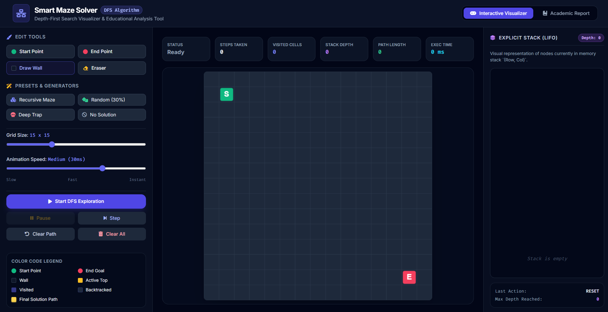

# 🧩 Smart Maze Solver Using DFS

An interactive, web-based graphical application for solving mazes using the **Depth-First Search (DFS)** graph traversal algorithm. Built with an explicit LIFO call-stack visualizer, live performance analytics, and an integrated academic report.

---

## 🖼️ Application Screenshot

---

## 🚀 Key Features

* **Interactive Grid Editor:** Custom-draw walls, place and drag Start (`S`) and End (`E`) nodes, and adjust grid dimensions dynamically ($8 \times 8$ to $30 \times 30$).
* **Preset Mazes & Generators:** Quick-load patterns including Recursive Backtracker mazes, deep traps, and no-solution boundary cases.
* **Explicit LIFO Call-Stack Visualizer:** Real-time visual tracking of active memory stack growth and shrinking coordinates.
* **Live Analytics Dashboard:** Live tracking of steps taken, cells visited, max stack depth, path length, and execution time in milliseconds.
* **Integrated Academic Report:** Built-in documentation covering problem statement, algorithm design, and complexity analysis.

---

## 📊 Complexity Analysis

* **Time Complexity:** $O(V + E)$ 
  * *Where $V$ is the number of grid cells (vertices) and $E$ is the movement connections (edges, up to 4 neighbors per cell).* In the worst case, every cell and edge is visited once.
* **Space Complexity:** $O(V)$ 
  * *Due to the explicit LIFO stack storage, visited hash/grid array, and parent tracking pointers required for path reconstruction in memory.*

---

## 🛠️ How to Run Locally

1. Clone or download this repository to your local machine.
2. Open the `smart_maze_solver_dfs.html` file in any modern web browser (Chrome, Firefox, Edge, Safari).
3. No external dependencies, servers, or installations required!

---

## 👥 Evaluation Note
Developed as an advanced algorithmic visualization tool demonstrating graph traversal, user interface design, and state-machine animation.
